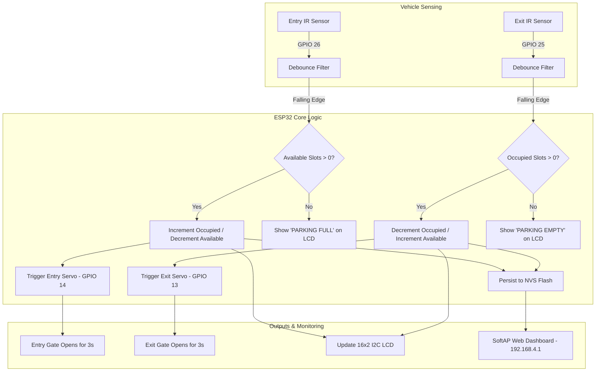

# 🚗 Smart Parking System (ESP32)

[](https://opensource.org/licenses/MIT)
[](https://www.espressif.com/en/products/socs/esp32)
[](https://www.arduino.cc/)
[]()

An intelligent, IoT-enabled automated parking management system engineered on the **ESP32 microcontroller**. It coordinates entry and exit boom barriers, accurate vehicle detection via debounced infrared (IR) sensors, on-site live statistics via an I2C LCD display, flash-memory persistence against power outages, and a standalone Wi-Fi Access Point serving a modern, mobile-responsive live web dashboard.

---

## ✨ Key Features

- **Automated Boom Barriers:** Entry and exit servo gates operate with precise 50 Hz PWM angle actuation (0° closed, 90° open) and non-blocking timers.
- **Debounced IR Detection:** State-machine edge detection eliminates sensor flicker and double-counting when vehicles pass slowly.
- **NVS Slot Count Persistence:** Uses the ESP32 `Preferences` library to save occupancy to internal Non-Volatile Storage (flash memory), surviving power loss or accidental reboots.
- **Embedded Web Dashboard:** Built-in Wi-Fi SoftAP hosts a responsive, dark-mode web dashboard accessible from any smartphone, tablet, or laptop without needing an external router.
- **On-Site 16x2 I2C Display:** Shows real-time occupied and available slot counts, dynamic full alerts, and reduces I2C bus traffic by updating only on changes.
- **Stability & Brownout Resistance:** Implements RTC controller register bypass and explicit GPIO pad reset for GPIO 25 and 26 to guarantee clean digital input operation.

---

## 📋 Hardware Bill of Materials (BOM)

| Component | Quantity | Description |
| :--- | :---: | :--- |
| **ESP32 Dev Module** | 1 | 30-pin or 38-pin ESP-WROOM-32 Development Board |
| **Infrared (IR) Obstacle Sensors** | 2 | Active-low digital obstacle detection modules (Entry & Exit) |
| **Micro Servos (SG90 or MG90S)** | 2 | Mini servo motors for Entry and Exit gate barriers |
| **16x2 LCD with I2C Backpack** | 1 | HD44780 LCD with PCF8574 I2C adapter (Default address `0x27`) |
| **External 5V Power Supply** | 1 | 5V / 2A DC supply (recommended for servos to avoid brownout) |
| **Breadboard & Jumper Wires** | — | Male-to-Male and Male-to-Female jumper wires |

---

## 🔌 Wiring & Pin Connections

> 💡 **Tip:** A standalone pinout guide is also available in [WIRING.md](file:///Users/ssp/Documents/Arduino/SmartPark/WIRING.md).

### Connection Table

| Component | Pin | ESP32 Connection | Operating Voltage | Description |
| :--- | :--- | :--- | :--- | :--- |
| **Entry IR Sensor** | VCC | `5V` (or `3V3`) | 3.3V – 5.0V | Power Supply |
| | GND | `GND` | Ground | Ground |
| | OUT | `GPIO 26` | 3.3V Logic | Active LOW vehicle detection |
| **Exit IR Sensor** | VCC | `5V` (or `3V3`) | 3.3V – 5.0V | Power Supply |
| | GND | `GND` | Ground | Ground |
| | OUT | `GPIO 25` | 3.3V Logic | Active LOW vehicle detection |
| **Entry Gate Servo** | Signal (Yellow/Orange) | `GPIO 14` | 3.3V / 5.0V PWM | Gate barrier PWM signal (50 Hz) |
| | VCC (Red) | `+5V (Ext PSU)` | 5.0V | External 5V rail (High Current) |
| | GND (Brown/Black) | `GND (Common)` | Ground | Common Ground |
| **Exit Gate Servo** | Signal (Yellow/Orange) | `GPIO 13` | 3.3V / 5.0V PWM | Gate barrier PWM signal (50 Hz) |
| | VCC (Red) | `+5V (Ext PSU)` | 5.0V | External 5V rail (High Current) |
| | GND (Brown/Black) | `GND (Common)` | Ground | Common Ground |
| **16x2 I2C LCD** | VCC | `5V` / `VIN` | 5.0V | Display logic & backlight power |
| | GND | `GND` | Ground | Ground |
| | SDA | `GPIO 21` | I2C Data | Hardware I2C SDA |
| | SCL | `GPIO 22` | I2C Clock | Hardware I2C SCL |

> ⚠️ **Important:** Connect the external power supply's ground (`GND`) to the ESP32 ground (`GND`) to establish a common ground reference. Never power both servos directly from the ESP32 3.3V pin.

---

## 🏗️ System Architecture & Workflow



---

## 🌐 Web Dashboard & Network Configuration

The ESP32 broadcasts its own Wi-Fi Access Point (SoftAP):

- **Default SSID:** `Smart_Parking_Hub`
- **Default Password:** `12345678`
- **Default Web Dashboard URL:** `http://192.168.4.1`

### Available HTTP Endpoints (Standard & Web Control)

| Endpoint | Method | Response | Description |
| :--- | :---: | :--- | :--- |
| `/` | `GET` | `text/html` | Responsive dark-mode live dashboard / controller |
| `/status` | `GET` | `application/json` | JSON payload with total, occupied, available, and gate states |
| `/api/gate/entry?action=pulse` | `GET` | `text/plain` | Open entry barrier with 3s auto-close timer *(Web Control)* |
| `/api/gate/entry?action=open` | `GET` | `text/plain` | Hold entry barrier open indefinitely *(Web Control)* |
| `/api/gate/entry?action=close` | `GET` | `text/plain` | Immediately close entry barrier *(Web Control)* |
| `/api/gate/exit?action=pulse` | `GET` | `text/plain` | Open exit barrier with 3s auto-close timer *(Web Control)* |
| `/api/gate/exit?action=open` | `GET` | `text/plain` | Hold exit barrier open indefinitely *(Web Control)* |
| `/api/gate/exit?action=close` | `GET` | `text/plain` | Immediately close exit barrier *(Web Control)* |
| `/api/slots?action=inc` | `GET` | `text/plain` | Manual vehicle entry override (+1 occupied) *(Web Control)* |
| `/api/slots?action=dec` | `GET` | `text/plain` | Manual vehicle exit override (-1 occupied) *(Web Control)* |
| `/reset` | `GET` | `text/plain` | Resets occupied count to 0 and syncs NVS flash |

---

## 🎮 Choosing Your Firmware Sketch

The repository includes three versions to fit every deployment scenario:

1. **[`SmartPark.ino`](file:///Users/ssp/Documents/Arduino/SmartPark/SmartPark.ino) (Standard Automated Mode):**
   - Autonomous IR sensing, auto-opening barrier servos, LCD updates, and read-only live web telemetry via ESP32 SoftAP (`192.168.4.1`).
   - Self-contained single-file sketch.

2. **[`SmartPark_WebControl/`](file:///Users/ssp/Documents/Arduino/SmartPark/SmartPark_WebControl/SmartPark_WebControl.ino) (Local Web App & LittleFS Remote):**
   - Bidirectional remote control over local Wi-Fi (Hold open, 3s Pulse, Close, and manual counter adjustments).
   - Serves separated web files (`index.html`, `style.css`, `app.js`) from ESP32 **LittleFS** flash memory.
   - Includes standalone IP input for direct browser testing.

3. **[`SmartPark_Firebase/`](file:///Users/ssp/Documents/Arduino/SmartPark/SmartPark_Firebase/SmartPark_Firebase.ino) (True Cloud IoT Mode — Worldwide Access):**
   - Connects to your Home/Office/Hotspot Wi-Fi and synchronizes with **Google Firebase Realtime Database**.
   - Bi-directional cloud control: control barrier gates and monitor slots from **anywhere in the world** over 4G/5G/cellular data.
   - Uses zero external third-party Firebase libraries (native HTTPS REST for maximum stability and easy compilation).
   - Paired with the live Web App in [`docs/`](file:///Users/ssp/Documents/Arduino/SmartPark/docs/index.html) hosted on GitHub Pages.

---

## 🚀 Live Cloud Web App (GitHub Pages)

The cloud dashboard in the [`docs/`](file:///Users/ssp/Documents/Arduino/SmartPark/docs/) folder is ready for 1-click publishing:

1. In your GitHub repository, go to **Settings** ➔ **Pages** (under Code and automation).
2. Under **Build and deployment** > **Branch**:
   - Select **`main`** branch.
   - Select folder **`/docs`**.
   - Click **Save**.
3. In ~60 seconds, your dashboard is live at:
   **`https://sanjaysprasad.github.io/Smart-Parking-System/`**
4. Open the link on any phone, tablet, or PC to monitor the parking lot and actuate gates globally!

---

## 💻 Terminal Controller CLI (`smartpark.py`)

Control and monitor your smart parking system directly from your macOS terminal using the built-in CLI:

```bash
# Launch the interactive menu
python3 smartpark.py

# Or run one-liner commands
python3 smartpark.py status                 # Show live ASCII status table
python3 smartpark.py watch                  # Auto-refreshing live terminal dashboard
python3 smartpark.py entry pulse            # Open entry gate (3s pulse)
python3 smartpark.py entry open             # Hold entry gate open
python3 smartpark.py entry close            # Close entry gate
python3 smartpark.py exit pulse             # Open exit gate (3s pulse)
python3 smartpark.py inc                    # Add vehicle (+1)
python3 smartpark.py dec                    # Remove vehicle (-1)
python3 smartpark.py reset                  # Reset all slots to 0
```

---

## ⚙️ Software Setup & Installation

### 1. Arduino IDE Setup
1. Install [Arduino IDE](https://www.arduino.cc/en/software) (version 2.0+ recommended).
2. Install the ESP32 Board Package:
   - Go to **File** > **Preferences** (or `Cmd + ,` on macOS).
   - In *Additional Board Manager URLs*, add:
     ```
     https://raw.githubusercontent.com/espressif/arduino-esp32/gh-pages/package_esp32_index.json
     ```
   - Go to **Tools** > **Board** > **Boards Manager**, search for `esp32` by Espressif Systems, and click **Install**.

### 2. Install Required Libraries
Open the **Library Manager** (`Cmd + Shift + I` / `Ctrl + Shift + I`) in Arduino IDE and install:
- **LiquidCrystal_I2C** by Frank de Brabander (or Marco Schwartz)
- **ESP32Servo** by Kevin Harrington / John K. Bennett

*(The `WiFi`, `WebServer`, and `Preferences` libraries are built into the ESP32 core package).*

### 3. Flash the Firmware
1. Open [`SmartPark.ino`](file:///Users/ssp/Documents/Arduino/SmartPark/SmartPark.ino) in Arduino IDE.
2. Select your board under **Tools** > **Board** (e.g., `ESP32 Dev Module`).
3. Select your serial port under **Tools** > **Port**.
4. Click **Upload** (`Cmd + U` / `Ctrl + U`).
5. Open the **Serial Monitor** at **115200 baud** to view real-time diagnostics.

---

## 🔧 Configurable Parameters

In [`SmartPark.ino`](file:///Users/ssp/Documents/Arduino/SmartPark/SmartPark.ino), you can customize operational constants:

```cpp
const int TOTAL_SLOTS = 20;             // Total number of parking bays
const int CLOSED_ANGLE = 0;             // Servo angle when barrier is closed
const int OPEN_ANGLE   = 90;            // Servo angle when barrier is open
const unsigned long GATE_TIME = 3000;   // Barrier open duration (milliseconds)
const unsigned long DEBOUNCE_TIME = 50; // IR flicker rejection window (ms)
```

---

## 📄 License

This project is open-source and licensed under the [MIT License](file:///Users/ssp/Documents/Arduino/SmartPark/LICENSE) by **Marichinthikuka**.
